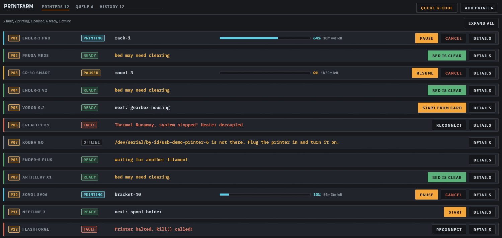
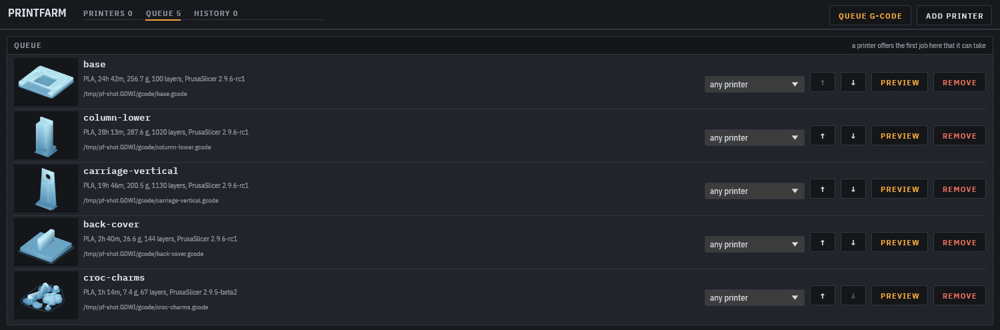
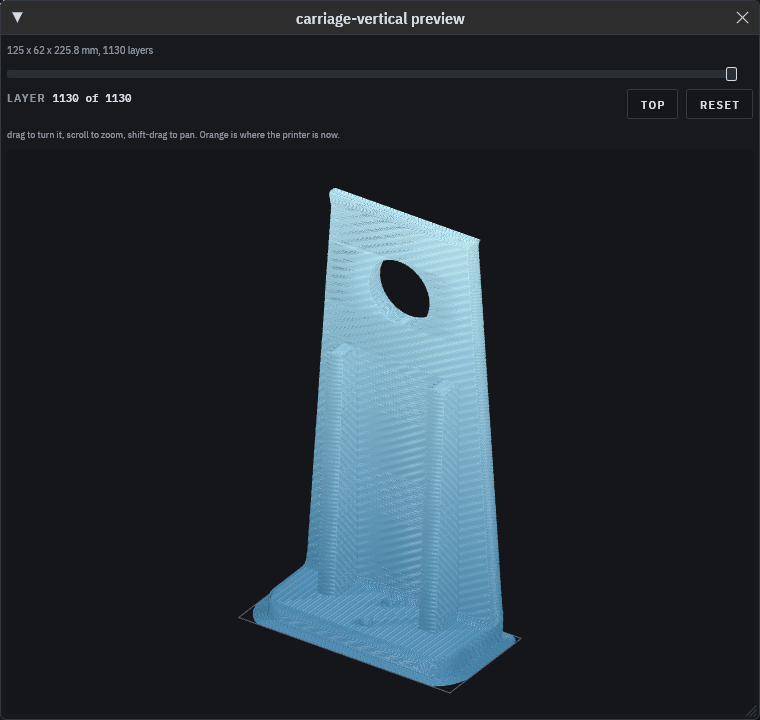

# printfarm

One window for all your 3D printers. Queue G-code, see every printer at a glance,
and watch the part being drawn layer by layer as it prints.

Part of the [bench suite](https://github.com/v0l/bench-suite), a launcher that installs, updates
and starts it alongside the other bench tools.



- **Prints survive printfarm.** A job is copied to the printer's SD card and printed from
  there, so closing the app or pulling the cable doesn't stop it. Open printfarm again and it
  picks the print back up.
- **A queue with pictures.** Drop G-code on the window. Every job shows the part, its time and
  filament, and the first printer that's free offers to start it.
- **3D preview from the G-code itself**, for any slicer. On a running printer it follows the
  print and shows the bead being laid down now.
- **Camera, temperatures, bed mesh, SD card files and a console** for each printer.
- **USB sticks and SD cards:** copy the queue to a card with names the firmware can open.



<p align="center"></p>

Marlin printers over USB work today. Moonraker, OctoPrint, PrusaLink and Bambu LAN are planned.

## Install

Grab a build for Linux, macOS or Windows from the
[releases page](https://github.com/v0l/printfarm/releases), or install it from the
[bench suite](https://github.com/v0l/bench-suite).

Click "add printer", pick the port and press "detect". To try it without a printer:

```sh
printfarm demo
```

## More

[docs/guide.md](docs/guide.md) covers how jobs reach the printer, SD cards, the file manager,
the bed mesh, the preview, config files, the command line and development.

GPL-3.0-or-later. Copyright © 2026 Kieran Harkin. You may share and change it under the terms of
the GNU General Public License, version 3 or any later version; see [LICENSE](LICENSE). Releases
before the next release were published under MIT and stay available under it.
